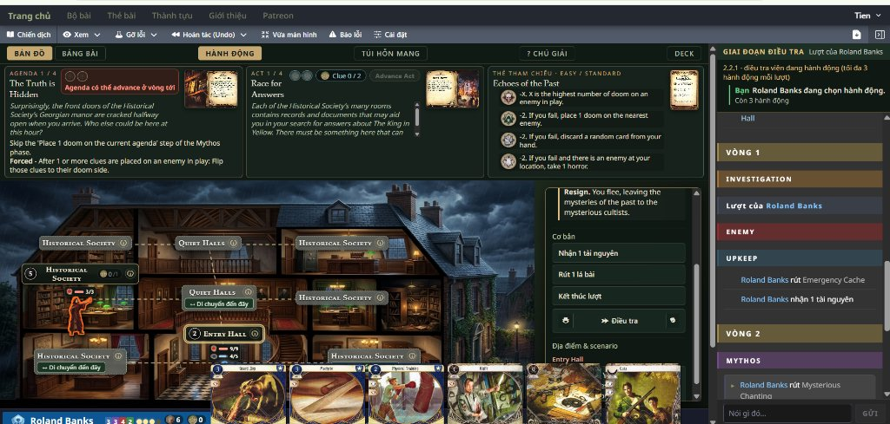

# Bản đồ Toàn cảnh Trực quan (Interactive Scene Maps)

Tính năng **Scene Map (Bản đồ toàn cảnh trực quan)** là một bước nâng cấp lớn về mặt trải nghiệm thị giác cho dự án Arkham Horror LCG Online. Thay vì chỉ nhìn các thẻ bài địa điểm hình chữ nhật được xếp trên mặt bàn lưới trừu tượng, người chơi sẽ được bước chân vào một không gian sống động, bám sát từng bối cảnh của cốt truyện.

---

## 🌟 Điểm nổi bật (Key Features)

### 1. Không gian thị giác sống động (Atmospheric 2.5D & Isometric Perspective)
- **Mặt cắt kiến trúc 2.5D (Architectural Cutaway)**: Dành cho các công trình nhiều tầng (ví dụ: Biệt thự Hội Lịch sử trong *Echoes of the Past*, Câu lạc bộ Clover trong *The House Always Wins*, dinh thự Hemlock...). Người chơi có thể nhìn xuyên thấu vào từng căn phòng, cầu thang và hành lang kết nối giữa các tầng.
- **Góc nhìn toàn cảnh từ trên cao (High-Angle Bird's-Eye / Isometric)**: Dành cho các kịch bản ngoại cảnh, đường phố thị trấn Arkham, bờ biển Innsmouth, nghĩa trang u ám, khu rừng cấm hay các chiều không gian siêu thực.

### 2. Standee nhân vật động (Dynamic Investigator Standees)
- Story Asset hình người hoặc thú có sprite sẽ xuất hiện dưới dạng standee khi đặt tại hoặc gắn vào địa điểm. Khi chuyển vào khu vực chơi của một điều tra viên, lá bài chỉ hiển thị trong khu vực chơi đó. Bấm vào standee để chọn lá bài hoặc mở các khả năng hiện có.
- Điều tra viên không còn là tên bài khô khan mà xuất hiện dưới dạng **Standee nhân vật** đứng trực tiếp tại vị trí địa điểm.
- **Hiệu ứng viền sáng (Action Glow)**: Nhân vật đang trong lượt hành động sẽ có viền sáng nổi bật, giúp theo dõi trạng thái bàn chơi trong các ván chơi nhiều người (Multiplayer) dễ dàng.

### 3. Thao tác tương tác trực tiếp (Direct Interactive Location Plates)
- Từng phòng/địa điểm có bảng thông tin (Plate) tích hợp:
  - Hiển thị rõ số **Manh mối (Clues)**, **Độ che giấu (Shroud)**, số lượng **Doom** và kẻ thù hiện diện.
  - Số manh mối còn lại nằm ngay trên mặt token và cập nhật theo ván chơi. Rê chuột lên token để xem số in gốc nếu có.
  - Các đường nối vàng (Connection Lines) trực quan hóa các đường đi hợp lệ giữa các phòng.
  - Các nút hành động tức thời: **"Di chuyển đến đây" (Move here)** hoặc **"Điều tra" (Investigate)** ngay trên bảng điều khiển vị trí mà không cần tìm kiếm thẻ trong tay hay danh sách dài.

### 4. Chuyển đổi linh hoạt 2 chế độ xem (Seamless Dual-View)
- Người chơi có thể tự do chuyển đổi giữa:
  - **BẢN ĐỒ (Scene Map)**: Không gian đồ họa nhập vai cao độ.
  - **BẢNG BÀI (Card Board)**: Bàn chơi thẻ truyền thống cho những người thích phong cách tabletop cổ điển.
- Trạng thái trò chơi được đồng bộ hoá 100% theo thời gian thực giữa hai chế độ.

### 5. Tối ưu cho thiết bị di động & Cảm ứng (Touch & Responsive Layout)
- Hỗ trợ đầy đủ phóng to/thu nhỏ (Pinch-to-zoom) và di chuyển góc nhìn (Pan/Drag).
- Giao diện tự động thích ứng thông minh trên PC, máy tính bảng (Tablet) và điện thoại thông minh (Phone) với bảng hành động dạng Bottom Sheet tiện lợi.

---

## 🗺️ Các chiến dịch và kịch bản đã hỗ trợ

Hệ thống Scene Map hiện đã được thiết kế và tích hợp cho hầu hết các chiến dịch lớn:

| Chiến dịch (Campaign) | Kịch bản tiêu biểu có Scene Map |
| :--- | :--- |
| **Night of the Zealot** | *The Midnight Masks*, *The Devourer Below* |
| **The Dunwich Legacy** | *Extracurricular Activity*, *The House Always Wins*, *The Miskatonic Museum*, *The Essex County Express*, *Blood on the Altar*, *Undimensioned and Unseen*, *Where Doom Awaits*, *Lost in Time and Space* |
| **The Path to Carcosa** | *Curtain Call*, *The Last King*, *Echoes of the Past*, *The Unspeakable Oath*, *A Phantom of Truth*, *The Pallid Mask*, *Black Stars Rise*, *Dim Carcosa* |
| **The Dream-Eaters** | *Beyond the Gates of Sleep*, *Waking Nightmare*, *The Search for Kadath*, *A Thousand Shapes of Horror*, *Dark Side of the Moon*, *Point of No Return*, *Where the Gods Dwell*, *Weaver of the Cosmos* |
| **The Feast of Hemlock Vale** | *Vale Day / Night*, *Hemlock House*, *Silent Heath*, *Lost Sister*, *The Thing in the Depths*, *Twisted Hollow*, *The Longest Night*, *Fate of the Vale* |
| **The Scarlet Keys** | *Riddles and Rain*, *Dead Heat*, *Sanguine Shadows*, *Dealings in the Dark*, *Dancing Mad*, *On Thin Ice*, *Dogs of War*, *Shades of Suffering*, *Without a Trace*, *Congress of the Keys* |
| **Side Stories & Challenge** | *Murder at the Excelsior Hotel*, *The Curse of the Rougarou*, và các kịch bản ngoại truyện khác |

---

## 🛠️ Quy trình tạo mới & Hiệu chỉnh toạ độ (For Contributors)

The Search for Kadath đổi nền theo vùng đang chơi. Trong A Thousand Shapes of Horror, Endless Descent đổi vị trí các bậc thang theo lá. Weaver of the Cosmos chuyển từ cầu tơ dọc sang vòng tám ô, với thân và chân Atlach-Nacha tương tác được khi có lựa chọn tương ứng.

Mỗi Scene Map được thiết kế dựa trên:
1. **Lưới toạ độ Backend Haskell**: Đối chiếu ma trận `locationLayout` và danh sách kết nối trong `backend/arkham-api/library/Arkham/Scenario/Scenarios/`.
2. **Quy chuẩn mỹ thuật & Prompt**: Xem chi tiết tại hướng dẫn [.agents/skills/arkham-overview-art/SKILL.md](../.agents/skills/arkham-overview-art/SKILL.md).
3. **Hiệu chỉnh toạ độ (Anchor Calibration)**: Sử dụng các script cân chỉnh tại `scripts/calibrate_*.py` và cấu hình anchor tại `frontend/src/arkham/hemlock-overview.ts`.
