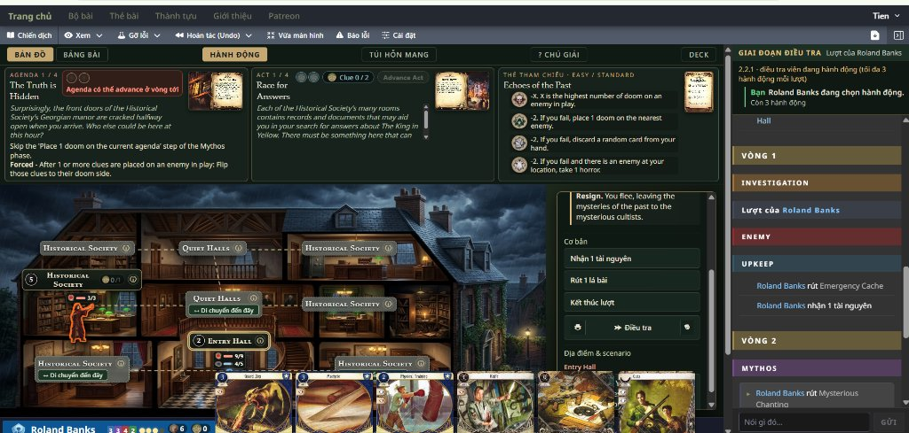

# Bản đồ Toàn cảnh Trực quan (Interactive Scene Maps)

Tính năng **Scene Map (Bản đồ toàn cảnh trực quan)** là một bước nâng cấp lớn về mặt trải nghiệm thị giác cho dự án Arkham Horror LCG Online. Thay vì chỉ nhìn các thẻ bài địa điểm hình chữ nhật được xếp trên mặt bàn lưới trừu tượng, người chơi sẽ được bước chân vào một không gian sống động, bám sát từng bối cảnh của cốt truyện.

---

## 🌟 Điểm nổi bật (Key Features)

### 1. Không gian thị giác sống động (Atmospheric 2.5D & Isometric Perspective)
- **Mặt cắt kiến trúc 2.5D (Architectural Cutaway)**: Dành cho các công trình nhiều tầng (ví dụ: Biệt thự Hội Lịch sử trong *Echoes of the Past*, Câu lạc bộ Clover trong *The House Always Wins*, dinh thự Hemlock...). Người chơi có thể nhìn xuyên thấu vào từng căn phòng, cầu thang và hành lang kết nối giữa các tầng.
- **Góc nhìn toàn cảnh từ trên cao (High-Angle Bird's-Eye / Isometric)**: Dành cho các kịch bản ngoại cảnh, đường phố thị trấn Arkham, bờ biển Innsmouth, nghĩa trang u ám, khu rừng cấm hay các chiều không gian siêu thực.

### 2. Standee nhân vật động (Dynamic Investigator Standees)
- Story Asset hình người hoặc thú có sprite sẽ xuất hiện dưới dạng standee khi đặt tại hoặc gắn vào địa điểm. Khi chuyển vào khu vực chơi của một điều tra viên, lá bài chỉ hiển thị trong khu vực chơi đó. Bấm vào standee để chọn lá bài hoặc mở các khả năng hiện có.
- Điều tra viên không còn là tên bài khô khan mà xuất hiện dưới dạng **Standee nhân vật** đứng trực tiếp tại vị trí địa điểm.
- **Hiệu ứng viền sáng (Action Glow)**: Nhân vật đang trong lượt hành động sẽ có viền sáng nổi bật, giúp theo dõi trạng thái bàn chơi trong các ván chơi nhiều người (Multiplayer) dễ dàng.

### 3. Thao tác tương tác trực tiếp (Direct Interactive Location Plates)
- Từng phòng/địa điểm có bảng thông tin (Plate) tích hợp:
  - Hiển thị rõ số **Manh mối (Clues)**, **Độ che giấu (Shroud)**, số lượng **Doom** và kẻ thù hiện diện.
  - Số manh mối còn lại nằm ngay trên mặt token và cập nhật theo ván chơi. Rê chuột lên token để xem số in gốc nếu có.
  - Các đường nối vàng (Connection Lines) trực quan hóa các đường đi hợp lệ giữa các phòng.
  - Các nút hành động tức thời: **"Di chuyển đến đây" (Move here)** hoặc **"Điều tra" (Investigate)** ngay trên bảng điều khiển vị trí mà không cần tìm kiếm thẻ trong tay hay danh sách dài.

### 4. Chuyển đổi linh hoạt 2 chế độ xem (Seamless Dual-View)
- Người chơi có thể tự do chuyển đổi giữa:
  - **BẢN ĐỒ (Scene Map)**: Không gian đồ họa nhập vai cao độ.
  - **BẢNG BÀI (Card Board)**: Bàn chơi thẻ truyền thống cho những người thích phong cách tabletop cổ điển.
- Trạng thái trò chơi được đồng bộ hoá 100% theo thời gian thực giữa hai chế độ.
- Thanh chỉ số điều tra viên hiển thị các thay đổi thường trực khi nguồn còn hiệu lực. Ví dụ, Four of Cups đang trong vùng chơi cho +1 Willpower và hiện `5(4+1)`; modifier của The Hierophant chỉ được tính trong lần kiểm tra tương ứng.

### 5. Tối ưu cho thiết bị di động & Cảm ứng (Touch & Responsive Layout)
- Khi sidebar ghim bên phải, Hành động chiếm khoảng hai phần ba chiều cao còn lại dưới trạng thái lượt. Hành động và Nhật ký cuộn riêng, còn nút Kết thúc lượt và ô chat nằm ở cuối mỗi vùng. Nút sidebar thu hoặc mở cả hai phần, kể cả khi bật Fit to screen.
- Khi Nhật ký dùng ngăn kéo (cửa sổ từ 800 px trở xuống), Hành động ở cạnh hoặc dưới bản đồ theo bố cục màn hình. Trên điện thoại, danh sách nằm ngay dưới bản đồ trong trang.
- Thanh nhiệm vụ (Agenda / Act / Reference) co theo **bề rộng thật của vùng bản đồ**. Khi vùng bản đồ dưới 1100 px hoặc thấp, thanh gập thành hàng chip (bấm ▾ để mở đầy đủ).
- Thanh điều khiển (Bản đồ / Bảng bài) nằm trong thanh game khi đủ chỗ. Khi thiếu chỗ, nó tách thành hàng riêng và các nút ít dùng (Đội, Chú giải, Bộ bài…) gập vào menu ⋯.
- Ảnh mặt B của Act và Agenda đã giải quyết nằm cạnh ảnh lá hiện tại, cùng kích thước. Trong ô Tham chiếu, các token dùng chung hiệu ứng nằm trên một dòng với một giá trị và một mô tả.
- Bấm một địa điểm khác chỗ đang đứng: bảng hành động chuyển sang mô tả địa điểm đó (đường nối, nút Di chuyển / Điều tra). Nút ← hoặc phím Esc quay lại danh sách hành động.
- Bảng tên địa điểm tự dịch lên/xuống một chút khi bị đè lên nhau; nút mũi tên trên đường nối tự trượt ra khỏi bảng tên. Vị trí bạn tự kéo được giữ nguyên.
- Phóng to/thu nhỏ và kéo bản đồ (zoom/pan) hiện đang tắt (`MAP_ZOOM_ENABLED` trong `frontend/src/arkham/mapViewport.ts`).

---

## 🗺️ Các chiến dịch và kịch bản đã hỗ trợ

Hệ thống Scene Map hiện đã được thiết kế và tích hợp cho hầu hết các chiến dịch lớn:

| Chiến dịch (Campaign) | Kịch bản tiêu biểu có Scene Map |
| :--- | :--- |
| **Night of the Zealot** | *The Midnight Masks*, *The Devourer Below* |
| **The Dunwich Legacy** | *Extracurricular Activity*, *The House Always Wins*, *The Miskatonic Museum*, *The Essex County Express*, *Blood on the Altar*, *Undimensioned and Unseen*, *Where Doom Awaits*, *Lost in Time and Space* |
| **The Path to Carcosa** | *Curtain Call*, *The Last King*, *Echoes of the Past*, *The Unspeakable Oath*, *A Phantom of Truth*, *The Pallid Mask*, *Black Stars Rise*, *Dim Carcosa* |
| **The Dream-Eaters** | *Beyond the Gates of Sleep*, *Waking Nightmare*, *The Search for Kadath*, *A Thousand Shapes of Horror*, *Dark Side of the Moon*, *Point of No Return*, *Where the Gods Dwell*, *Weaver of the Cosmos* |
| **The Feast of Hemlock Vale** | *Vale Day / Night*, *Hemlock House*, *Silent Heath*, *Lost Sister*, *The Thing in the Depths*, *Twisted Hollow*, *The Longest Night*, *Fate of the Vale* |
| **The Scarlet Keys** | *Riddles and Rain*, *Dead Heat*, *Sanguine Shadows*, *Dealings in the Dark*, *Dancing Mad*, *On Thin Ice*, *Dogs of War*, *Shades of Suffering*, *Without a Trace*, *Congress of the Keys* |
| **Side Stories & Challenge** | *Murder at the Excelsior Hotel*, *The Curse of the Rougarou*, và các kịch bản ngoại truyện khác |

---

## 🛠️ Quy trình tạo mới & Hiệu chỉnh toạ độ (For Contributors)

The Search for Kadath đổi nền theo vùng đang chơi. Trong A Thousand Shapes of Horror, Endless Descent đổi vị trí các bậc thang theo lá. Weaver of the Cosmos chuyển từ cầu tơ dọc sang vòng tám ô, với thân và chân Atlach-Nacha tương tác được khi có lựa chọn tương ứng.

The Midnight Masks đổi sang ảnh nhà cháy rụi khi Campaign Log ghi nhận kết quả đốt nhà ở The Gathering. Murder at the Excelsior Hotel dùng mặt cắt khách sạn với điểm neo cho cả 10 địa điểm. The Blob That Ate Everything dùng ảnh riêng cho từng lá, đặt theo ô thực tế trên lưới Blackwater.

Spreading Flames dùng mặt cắt một phòng trong ký túc xá. Trong Agenda 1 mặt A, nền chỉ hiện lửa trong phòng nếu phòng đang cháy. Từ Agenda 1 mặt B, lửa nền bắt đầu trên mái cánh ký túc xá, rồi lan rộng từ cùng điểm khi sang Agenda 2 mặt B hoặc Agenda 3. Các lá *Fire!* vẫn hiển thị tại địa điểm thực tế trong ván. Các ảnh dùng chung điểm neo và góc zoom.

Extracurricular Activity và Return to dùng chung tranh khuôn viên Miskatonic. Faculty Offices nằm ở tầng ba của Administration Building và Alchemy Labs nằm dưới Science Building. Orne Library và Warren Observatory có điểm neo riêng cho hai nhánh chọn ngẫu nhiên của Return to. Từ Act 2B hoặc Agenda 2B, nền chuyển sang cảnh biến động ở khu Khoa học, dùng cùng điểm neo. Nhãn của các địa điểm xuất hiện khi game đưa lá vào bàn.

Trong Dunwich, The House Always Wins thể hiện thiệt hại tại lối vào từ Agenda 2B. The Miskatonic Museum tối dần theo Agenda. The Essex County Express mở rộng khe nứt khi Agenda tiến triển, còn các toa tiếp tục bám vị trí thực tế. Blood on the Altar chuyển sang đêm và đặt Hidden Chamber cạnh địa điểm tìm thấy nó. Undimensioned and Unseen chuyển sang mưa bão từ Agenda 2B. Where Doom Awaits thể hiện cảnh ban đầu, biến dạng và cổng mở theo Agenda và Act.

Curtain Call thể hiện lửa, chất nhầy, nước, sương hoặc dây leo tại các location có horror tùy lá Act đã giải quyết, kể cả các nhánh Return to. The Last King đổi không khí dinh thự từ Agenda 1B. The Unspeakable Oath có bốn ô phòng giam quanh hành lang tầng hầm và chuyển sang báo động khi Act 3 lật. A Phantom of Truth hiện bình minh trong mặt sau Agenda. The Pallid Mask giữ lưới địa điểm động và chuyển nền khi đường hầm bắt đầu sụp. Black Stars Rise thể hiện lũ và xoáy trời theo hai bộ Agenda độc lập, với Abbey Tower ở trên cao và các phòng tu viện có điểm riêng. Dim Carcosa mở đầu bằng ảo ảnh nhà hát rồi chuyển sang toàn cảnh thành phố.

Traces to Nowhere dùng toàn cảnh Arkham ở đầu ván. Khi Ethereal Perch hoặc một địa điểm Otherworld khác vào bàn, nền mở thêm mặt cắt bên dưới nhà tang lễ. Các điểm trên phố vẫn dùng được, kể cả khi cả nhóm được đưa xuống Bone Pit ở Agenda 4. Waking Nightmare, New Horizons và The Midwinter Gala đặt các lá úp tại điểm tạm, rồi dời nhãn vào phòng tương ứng khi lật.

River of Blood đổi ngày/đêm theo bốn Agenda và mặt B. Nhánh Dusk của Hard/Expert dùng hoàng hôn ở đầu ván. New Horizons có nền nhà máy trước khi mở hang và mặt cắt mở rộng sau khi địa điểm hang vào bàn, gồm biến thể ngày/đêm theo bộ location. Blood Money chuyển sang Bloody Night khi Foyer được thay bằng mã 13076b.

The Secret Name bắt đầu bằng mặt cắt nhà trọ. Khi Keziah's Room vào bàn, toàn cảnh chuyển sang các địa điểm dị giới. Return to có thêm bốn địa danh. Các phòng xáo dùng điểm tạm trước khi lật, và hai Strange Geometry có hai điểm riêng.

The Wages of Sin hiện trạng thái Spectral tại từng nơi đã lật, rồi chuyển toàn cảnh sau Agenda 1B. Chapel Attic và Chapel Crypt nằm trong mặt cắt mái và tầng ngầm của nhà nguyện. The Doom of Arkham Part II bắt đầu với Rivertown đã Ruined, các khu phố khác hiện hủy hoại khi lá Ruined tương ứng thay thế chúng.

In Too Deep có bốn mức cảnh thủy triều theo các mốc Agenda. Token nước trên từng location tiếp tục thể hiện mức ngập thực tế trong ván. Các biến thể cùng bố cục giữ điểm neo và góc zoom.

Curtain Call, Echoes of the Past và Dim Carcosa dùng chung tranh toàn cảnh cho bản gốc và Return to. Khi lật Lobby Doorway hoặc Backstage Doorway, nhãn chuyển từ cửa chung vào đúng phòng trong tranh. Hidden Library có điểm riêng khi được đưa vào ván. Các lá Dim Carcosa thay thế nhau trong cùng một khu vực dùng chung điểm neo. Scene Map chỉ đặt nhãn cho các địa điểm đang có trên bàn.

The House Always Wins, The Miskatonic Museum, For the Greater Good và các màn Twilight Estate chia sẻ tranh giữa bản gốc và Return to. Twilight Estate đổi sắc độ khi chuyển spectral. The Miskatonic Museum có sáu ô triển lãm, hiện vật xuất hiện tại ô đã chia khi lật lá. Return to The Gathering dùng mặt cắt nhà riêng có các phòng bổ sung.

The Essex County Express dùng tranh cầu cao qua sông Miskatonic, với khe nứt trên trời phía sau đoàn tàu. Mỗi toa xuất hiện theo ô đang có trên Card Board và được lấy khỏi Scene Map khi game gỡ ô đó. Khoang hành khách, toa ăn, toa ngủ, toa khách hạng sang, toa hàng và toa hành lý hiện nội thất khi được lật. Hai bản dùng chung nền.

The Forgotten Age dùng chung tranh giữa bản gốc và Return to theo từng màn. Tranh mới có Loading Docks và Hastings Estate, các phòng bổ sung của Pnakotus và ba vùng Return to của Shattered Aeons. Heart of the Elders I đi qua rừng tới cửa hang. Các ô Explore và các nhóm xáo có thể hiển thị phần minh họa trên lá đã lật.

The Western Wall, The Drowned Quarter, Queen of Ash và Hemlock House dùng tranh toàn cảnh có địa danh cố định. Lá úp dùng điểm tạm theo bố cục đã xáo; khi lật, nhãn đến đúng địa danh và đường nối theo kết nối thực tế của ván.

City of the Elder Things, các phòng Heart of Madness, Fatal Mirage, Court of the Ancients, The Grand Vault, Electric Nightmare và các khu rừng/toa tàu Circus dùng ảnh từng location bám ô hiện tại. Great Lift và Moving Platform đổi vị trí cùng lá; các bản sao cùng mã vẫn có ID riêng. Lá úp dùng ảnh chung để không lộ danh tính. Unstuck giữ thứ tự ô theo vòng sau khi hoán đổi.

Carnevale giữ vòng Venice cho tới khi game gỡ các location cũ và đưa Gondola vào bàn; lúc đó tranh chuyển sang toàn cảnh thuyền. Apiary chỉ thu gọn về Central Chamber ở nhánh Hive Mind, còn Lost Pilgrims giữ hang ban đầu. On Thin Ice giữ toàn vùng Alaska khi mở lair. Các thế giới Film Fatale, vùng ngầm Dagon và các pha Phantom đổi theo tập location đang có, nên tải lại ván hoặc Undo cũng khôi phục cảnh tương ứng.

School của Ages Unwound có ba Classroom và ba Ritual Circle riêng; Again có thể giữ cả ba vòng cùng lúc. Backstage của Erich Zann mở từng nội thất trong mặt cắt nhà hát. Strange Moons thay riêng khu mô phỏng, Boundary Beyond đổi riêng khu thời gian, Usher hủy hoại từng phòng và Constellation thể hiện ngập tại các phòng exhausted. Các biến thể được chọn từ snapshot công khai, không từ lịch sử thao tác trên trình duyệt.

Mỗi Scene Map được thiết kế dựa trên:
1. **Lưới toạ độ Backend Haskell**: Đối chiếu ma trận `locationLayout` và danh sách kết nối trong `backend/arkham-api/library/Arkham/Scenario/Scenarios/`.
2. **Quy chuẩn mỹ thuật & Prompt**: Xem chi tiết tại hướng dẫn [.agents/skills/arkham-overview-art/SKILL.md](../.agents/skills/arkham-overview-art/SKILL.md).
3. **Hiệu chỉnh toạ độ (Anchor Calibration)**: Sử dụng các script cân chỉnh tại `scripts/calibrate_*.py` và cấu hình anchor tại `frontend/src/arkham/hemlock-overview.ts`.
